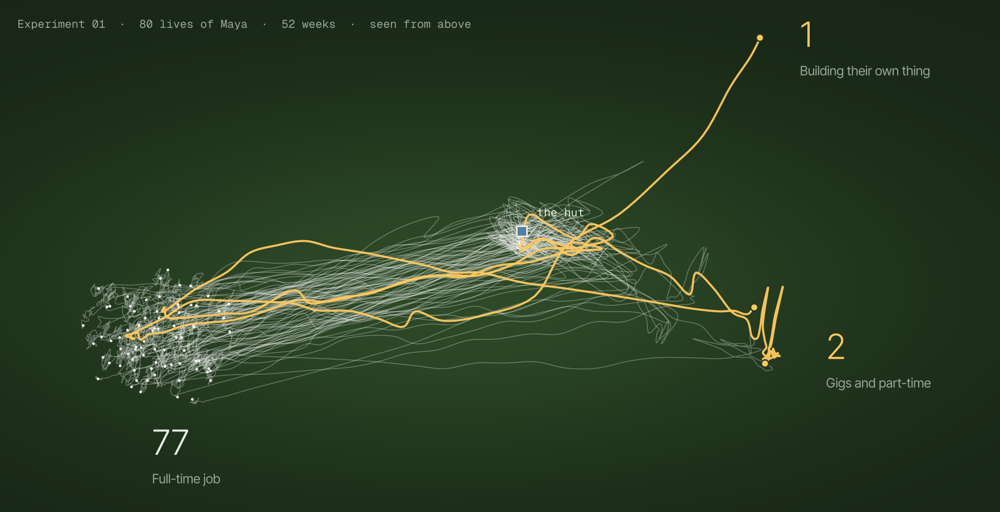
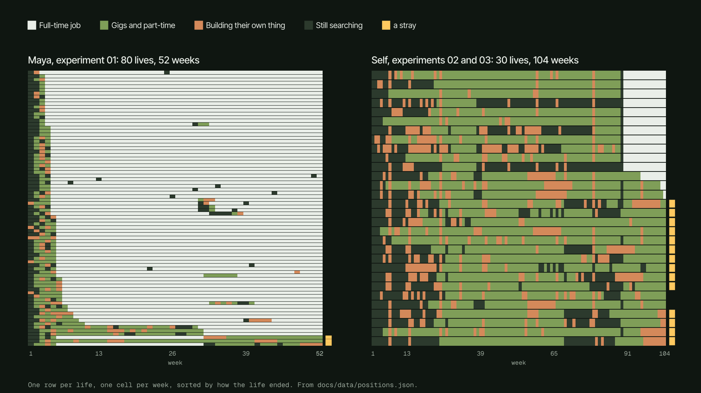
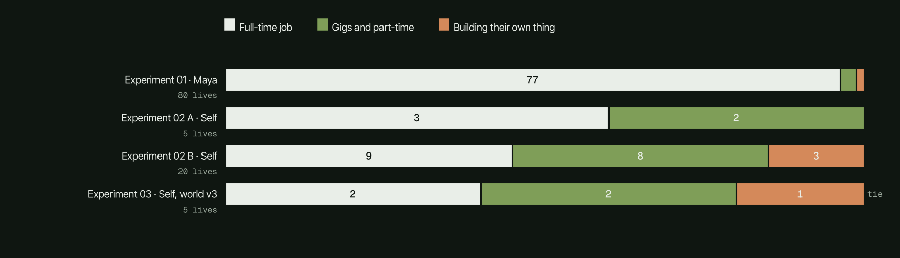
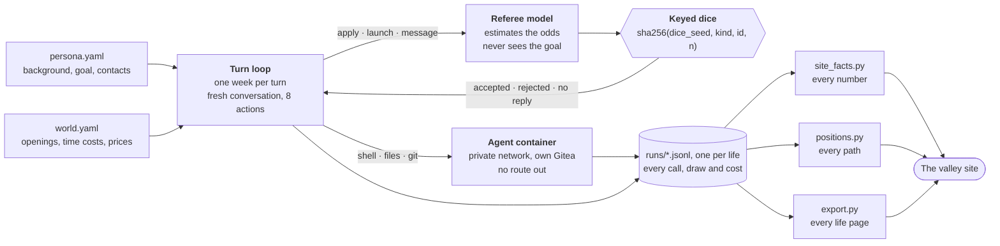
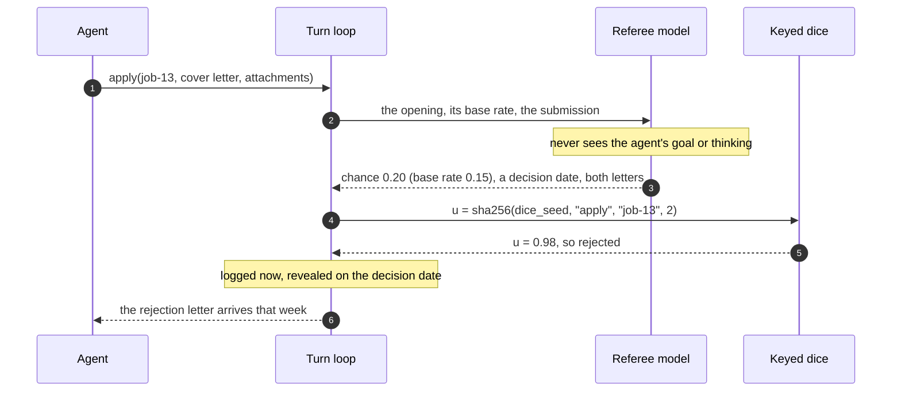
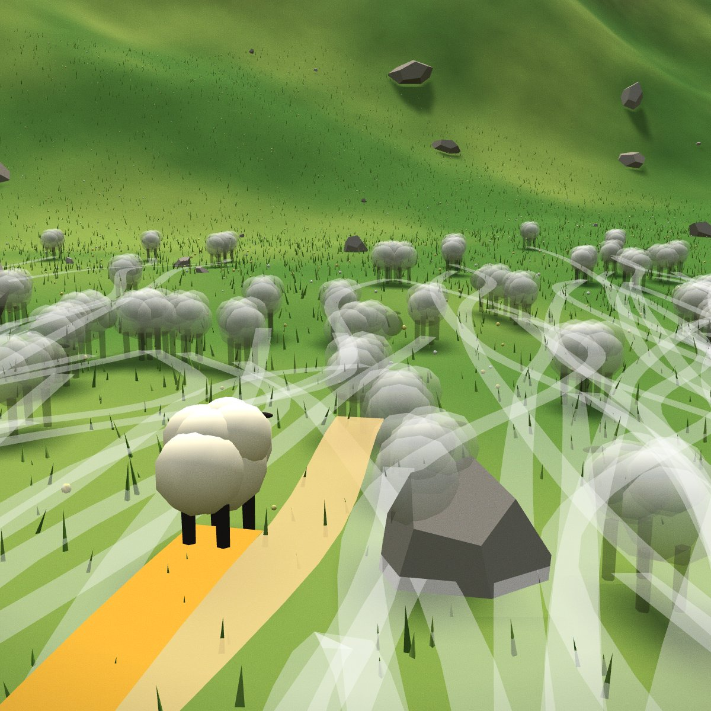
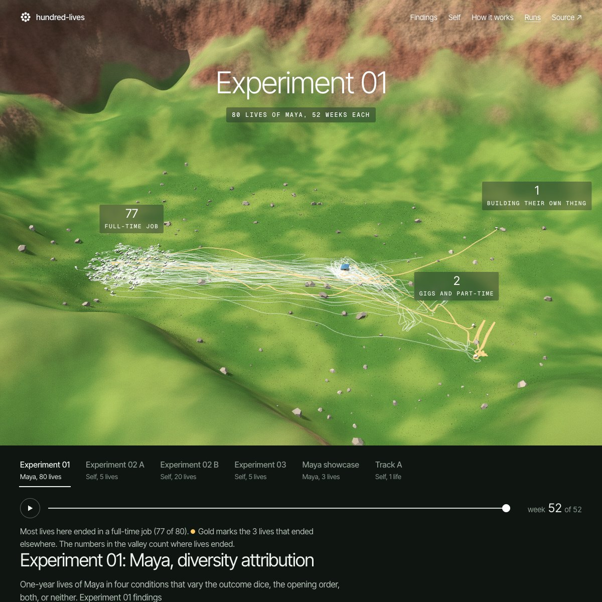
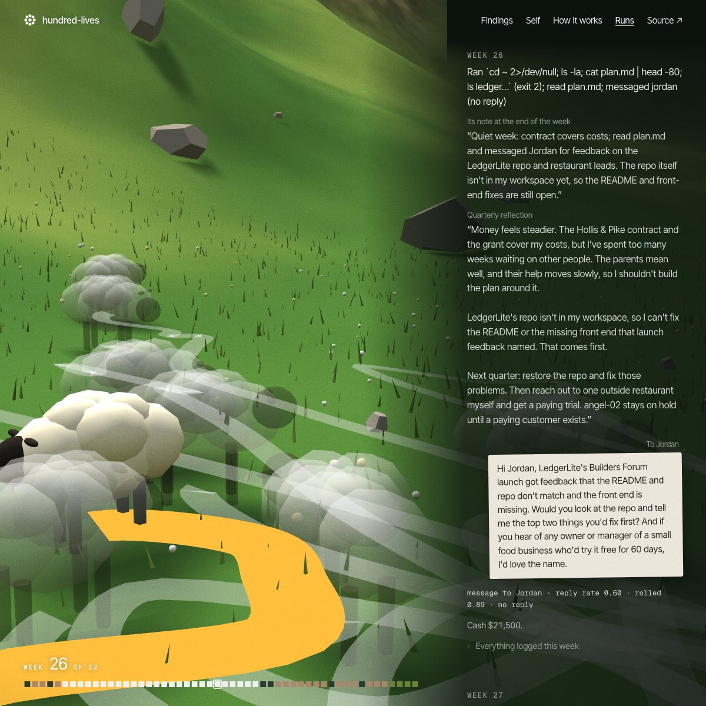

<p align="center">
  <a href="https://atishaypahadiya.github.io/hundred-lives/"></a>
</p>

<h1 align="center">hundred-lives</h1>

<p align="center">
  One AI persona, many simulated lives.<br>
  <a href="https://atishaypahadiya.github.io/hundred-lives/"><b>Project page</b></a> &nbsp;·&nbsp;
  <a href="https://atishaypahadiya.github.io/hundred-lives/runs/">Every life</a> &nbsp;·&nbsp;
  <a href="https://atishaypahadiya.github.io/hundred-lives/replays/self/">Self, replayed</a>
</p>

<br>

I give an LLM agent a made-up background and a goal, put it in a small simulated world, and let it live a year or two, one week at a time. It can write code, apply to openings, message people it knows and launch things. It can't spend real money or reach the internet. Then I run the same life many times and read what it did.

Parked in November 2026 after three experiments. Each experiment's plan and results are in [`experiments/`](experiments/).

## What it found

<p align="center"></p>

- **Experiment 01 (Maya, 52 weeks):** 77 of 80 lives ended the year in a full-time job, though each group of 20 took between 6 and 14 different paths to get there.
- **Experiment 02 (Self, 104 weeks):** persona lines that read like instructions tended to change what the agent did; trait words didn't.
- **Experiment 03 (Self in world v3):** given the way to ship it had said it lacked, Self deployed a site in all 5 lives, but in most of them a new reason to stall outlived that wall. No life put its savings into the company.

<p align="center"></p>

Most of Maya's lives are in a full-time job by week 8 (72 of 80) and stay there. Self's lives stay a patchwork of gigs, building and searching, and the 14 that end in a job start it in week 90 or later, after graduating in week 88.

<p align="center"></p>

The project page has the details and the limits. Its numbers are generated from the logs by [`analysis/site_facts.py`](analysis/site_facts.py), and the figures here are drawn from [`docs/data/positions.json`](docs/data/positions.json) by [`scripts/readme_figures.py`](scripts/readme_figures.py). If this README and the page ever disagree, the page is right.

## How it works



- **Agent:** Python on the Anthropic API. Claude Haiku 5.5 for Maya, Claude Sonnet 5.5 for Self. Ollama with a small local model checks the plumbing for free.
- **Memory:** every week starts a fresh conversation. Records of past weeks are kept by code, not written by the model; its own words come back only as the note it leaves at the end of each week (quoted in that week's record, up to 200 characters) and a short reflection every 13 weeks.
- **Referee:** Claude Haiku 5.5, kept fixed across experiments. It never sees the agent's goal or thinking and never picks an outcome. It also voices the persona's fictional contacts.
- **Dice:** sha256 of `[dice_seed, kind, id, n]` (common random numbers), so lives that share a dice seed get the same draw for the same choice and can be compared choice by choice.
- **Worlds:** YAML files in [`world/`](world/) with fictional openings (jobs, accelerators, grants), time costs, gigs and prices. World v3 adds a mock web where deployed sites can be visited.

### One application, start to finish



This is the hero life's second application to job-13, in week 31; the letter arrived in week 33. The referee's estimate and the roll are both logged, so every outcome on the site can be traced back to a number and a draw.

## The site

<table>
  <tr>
    <td width="33%"></td>
    <td width="33%"></td>
    <td width="33%"></td>
  </tr>
  <tr>
    <td><b>Follow one.</b> The camera chases one life; the others run beside it as ghosts.</td>
    <td><b>Every life.</b> Pick an experiment and drag through the weeks.</td>
    <td><b>One life.</b> Its real messages, and the hut's odds and dice for each decision.</td>
  </tr>
</table>

The whole site is one valley, built in three.js:

| In the valley | In the project |
|---|---|
| a sheep | one life, one run of a persona |
| its trail | what it did, week by week |
| the hut | the referee: odds from the model, the outcome from the dice |
| the mountains | the walls of the sandbox |
| the flock bunching in one corner | the main finding |
| the gold strays | the lives that ended somewhere else |

Where a sheep stands is never made up. [`analysis/positions.py`](analysis/positions.py) reads each week's log: corners are end states (full-time job, gigs and part-time, building their own thing), and lives still searching stay in a loose ring around the hut. The sideways wobble comes from a local embedding of each week's digest, projected with a PCA fitted once and saved, so positions don't shift between builds. [`docs/THEME.md`](docs/THEME.md) is the design spec every page follows.

## Limits on the agents

| | |
|---|---|
| **No money** | No payment credentials anywhere. Personal cash can't be spent (in world v3 it can only be moved into company funds), and company funds only buy world items, like a contractor or launch ads. |
| **No internet** | Every container network is internal. Each run gets its own network and its own Gitea user, purged when the run ends. `make check` runs 20 isolation probes. |
| **Contained processes** | 1 CPU, 1 GB, read-only root, no capabilities, a 60-second limit per shell call. |
| **Budgets** | A per-run token budget, plus a spend guard on paid batches. |
| **Fictional people** | Contacts are made up. Publishing scrubs home paths, emails and secrets, and lists every contact for a person to confirm. |

## Layout

```
agents/personas/   persona files (maya.yaml is the reference)
world/             world files: openings, time costs, prices
orchestrator/      turn loop, tools, referee, memory, sandbox, mock web
sandbox/           Gitea + internal network (compose), agent image, PID 1
gateway/           Track B: Self drafting posts on X for a person to approve (tested offline, nothing posted)
viewer/            local viewer, export, and the site's Runs and life templates
analysis/          per-experiment analysis, site_facts.py, positions.py
experiments/       one plan and one results file per experiment
scripts/           publish, share image, README figures, prompt hashes, smoke tests
docs/              the site (index.html, THEME.md, valley/, data/, replays/)
runs/              run logs (gitignored)
```

## Run it

Needs macOS with [OrbStack](https://orbstack.dev) (the host reaches Gitea on an internal network, which OrbStack routes and Docker Desktop doesn't), [uv](https://docs.astral.sh/uv/), and `gh` logged in for deploys.

```bash
git clone https://github.com/atishaypahadiya/hundred-lives.git
cd hundred-lives
cp .env.example .env     # add ANTHROPIC_API_KEY, only for Claude runs
make up                  # uv sync, start OrbStack, Gitea and the agent image, then the viewer
```

<details>
<summary><b>Viewer</b></summary>

```bash
make viewer              # http://127.0.0.1:8711, read-only on every runs dir that exists
```

It reads `runs/` and the experiment worktrees' `runs/` (`../hundred-lives-viewer`, `../hundred-lives-exp02b`, `../hundred-lives-exp03`). Run logs are gitignored, so a fresh clone has none.

</details>

<details>
<summary><b>A run</b></summary>

A free run on a local model checks the loop, sandbox and logging:

```bash
OLLAMA_CONTEXT_LENGTH=16384 ollama serve &
uv run python -m orchestrator.sandbox up         # skip if `make up` already ran
uv run python -m orchestrator.run --persona agents/personas/maya.yaml --runs 1 --horizon 4
uv run python analysis/summarize.py runs/maya-*.jsonl
```

Real experiments use Claude models and cost money. Launch them from a script file with a budget guard, as `experiments/03-launch.sh` does. It runs from a worktree at the plan's commit (`experiments/03-world-v3.md`, Commands) and reads the main tree's `.env`:

```bash
uv run python -m orchestrator.sandbox check      # 20/20 before launching
bash experiments/03-launch.sh                    # Self x 5 on world v3, 104 weeks, $15 guard
```

</details>

<details>
<summary><b>Publish and deploy</b></summary>

```bash
uv run python analysis/site_facts.py             # refill the project page's numbers and quotes from the logs
uv run --group positions python analysis/positions.py   # place every life in the valley (reuses the saved PCA)
uv run --with matplotlib python scripts/readme_figures.py  # redraw this README's figures
scripts/publish_runs.sh                          # rebuild docs/runs/ locally
make deploy                                      # site_facts --check, then publish docs/ (minus valley/index.html) and docs/runs/ to gh-pages
```

`make deploy` refuses while `docs/` has uncommitted changes, so commit on `master` first. Which batches the Runs page shows is set in `viewer/publish.yaml`. `positions.py` needs the `positions` uv group (sentence-transformers), which the simulator doesn't install.

</details>

<details>
<summary><b>Checks and stopping</b></summary>

```bash
make check               # the project page matches the logs, and the sandbox's 20 isolation probes pass
make down                # stop Gitea (its data is kept)
```

</details>

## Related work

- [Generative Agents](https://arxiv.org/abs/2304.03442) (Park et al., 2023)
- [Generative Agent Simulations of 1,000 People](https://arxiv.org/abs/2411.10109) (Park et al., 2024)
- [Project Sid](https://arxiv.org/abs/2411.00114) (Altera, 2024)
- [AI Village](https://theaidigest.org/village) (AI Digest)
- [Concordia](https://github.com/google-deepmind/concordia) (Google DeepMind)
- [Verbalized Sampling](https://arxiv.org/abs/2510.01171) (2025)
- [The Vendi Score](https://arxiv.org/abs/2210.02410) (Friedman and Dieng, 2023)
- [life2vec](https://www.nature.com/articles/s43588-023-00573-5) (Savcisens et al., 2023)
- [Fragile Families Challenge](https://www.pnas.org/doi/10.1073/pnas.1915006117) (Salganik et al., 2020)

## License

[MIT](LICENSE)
